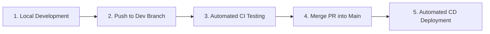

# Development, Testing, & Deployment Workflow Guide

This document outlines the end-to-end workflow for developing, testing, pushing, and deploying the **Buyootna** monorepo application.

---

## 📋 Overview of Workflow Lifecycle



---

## 🛠️ Phase 1: Local Development

### Prerequisites
- **Node.js**: v22 LTS
- **Package Manager**: `pnpm` (v10)
- **Container Engine**: Docker & Docker Compose

### 1. Install Workspace Dependencies
Run from the repository root:
```bash
pnpm install
```

### 2. Local Service Execution
- **Run Backend API**:
  ```bash
  pnpm --filter api start:dev
  ```
- **Run Mobile App (Expo)**:
  ```bash
  pnpm --filter buyootna start
  ```
- **Run Web Workspace Applications**:
  ```bash
  pnpm --filter "./apps/web/*" dev
  ```

### 3. Local Verification Before Pushing
Run type-checking and unit tests locally before committing changes:
```bash
# Type check TypeScript in Mobile App
pnpm --filter buyootna exec tsc --noEmit

# Run Backend API Unit Tests
pnpm --filter api test

# Run Mobile App Unit Tests
pnpm --filter buyootna test
```

---

## 🚀 Phase 2: Commit & Push

### Branching Strategy
- **`dev`**: Primary integration branch for active development and feature updates.
- **`main` / `master`**: Production-ready branch. Code merged here triggers production deployment.

### Commands to Commit and Push
```bash
# 1. Stage modified files
git add .

# 2. Commit with descriptive message
git commit -m "feat(module): description of feature or bugfix"

# 3. Push changes to dev branch
git push origin dev
```

---

## 🧪 Phase 3: Automated CI Pipeline (Continuous Integration)

When code is pushed to `dev` or a Pull Request is opened, GitHub Actions automatically runs the **CI Pipeline** ([`.github/workflows/ci.yml`](file://.github/workflows/ci.yml)).

### CI Pipeline Jobs
1. **Lint & Build Web Workspace** (`lint-and-build-workspace`):
   - Installs workspace dependencies with `--frozen-lockfile`.
   - Builds all Next.js applications located in `apps/web/*`.
2. **Test & Build Backend API** (`test-api`):
   - Generates Prisma ORM client (`pnpm --filter api exec prisma generate`).
   - Executes NestJS unit tests with Jest (`pnpm --filter api test`).
   - Builds production NestJS dist outputs.
3. **Test Mobile App** (`test-mobile`):
   - Executes Jest unit test suite for the Expo/React Native app (`pnpm --filter buyootna test`).
4. **Validate Docker Build** (`docker-build`):
   - Validates `docker-compose.yaml` configuration.
   - Builds all service Docker images (`docker compose build`).

---

## 🚢 Phase 4: Production Deployment (CD Pipeline)

When a Pull Request is merged from `dev` into `main` (or code is pushed directly to `main`), GitHub Actions automatically triggers the **CD Pipeline** ([`.github/workflows/cd.yml`](file://.github/workflows/cd.yml)).

### Automated CD Deployment Steps
1. **SSH Connection**: Establishes a secure SSH connection to the production server (`secrets.SSH_HOST`).
2. **Pull Code**: Navigates to target directory and pulls latest changes:
   ```bash
   git pull origin main
   ```
3. **Build & Re-launch Containers**:
   ```bash
   docker compose up -d --build
   ```
4. **Apply Database Migrations**:
   ```bash
   docker compose exec -T api pnpm prisma:migrate:deploy
   ```
5. **Clean Old Images**:
   ```bash
   docker system prune -f
   ```

---

## ⚡ Manual Deployment (Fallback)

If you ever need to trigger a deployment manually without pushing new code:

1. Go to the **GitHub Repository** -> **Actions** tab.
2. Select **CD Pipeline** from the left sidebar menu.
3. Click the **Run workflow** dropdown on the top right.
4. Select the `main` branch and click **Run workflow**.

---

## 🔍 Server Verification Commands

After deployment completes, connect to your server via SSH to inspect container status and logs:

```bash
# Check status of running containers
docker ps

# Stream logs for the backend API
docker compose logs -f api

# Stream logs for all services
docker compose logs -f
```
