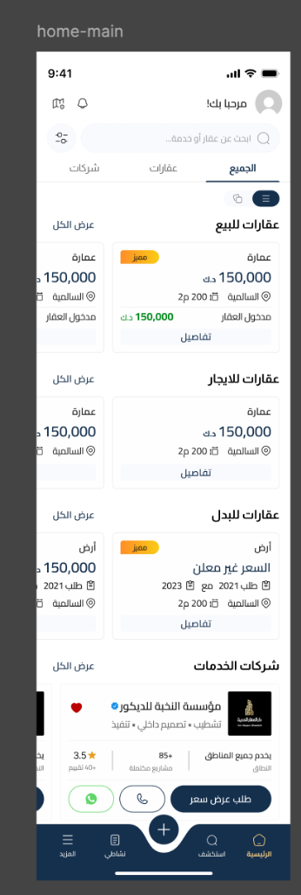
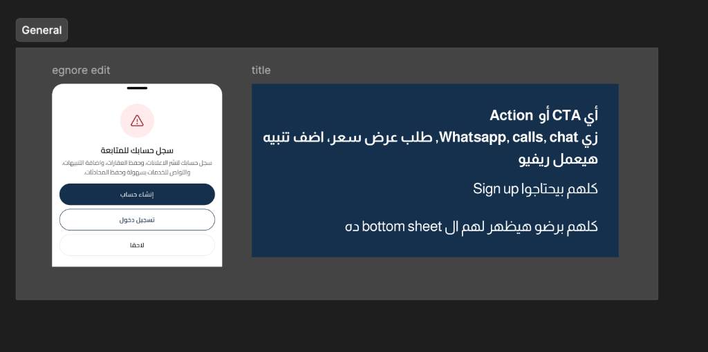
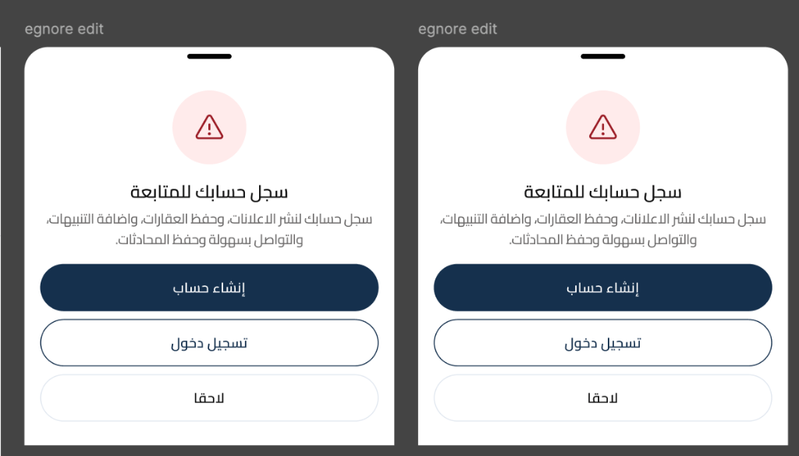
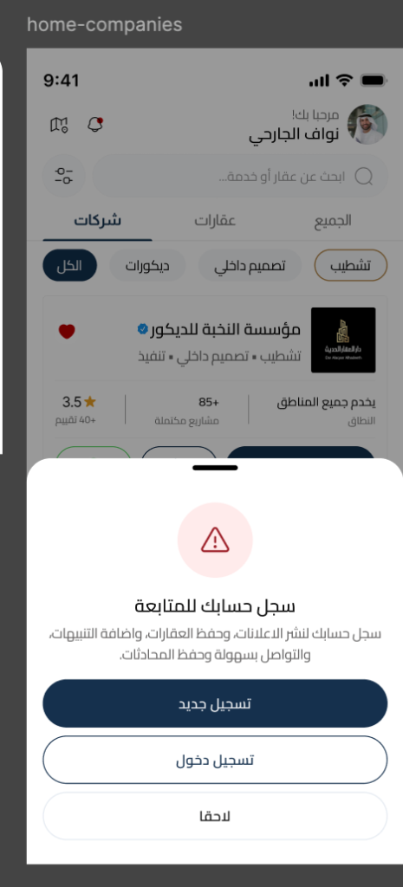
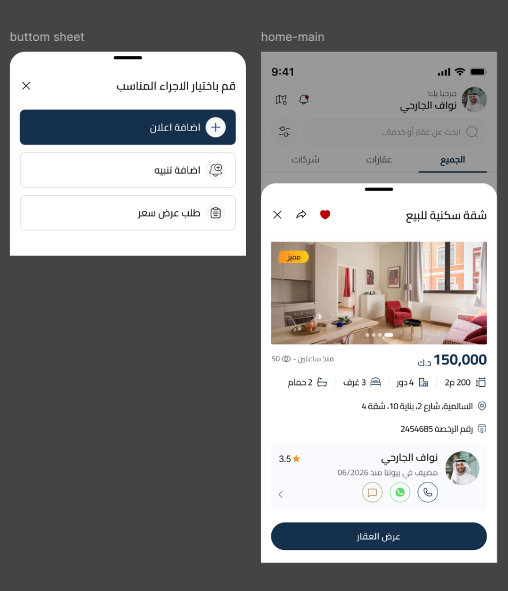
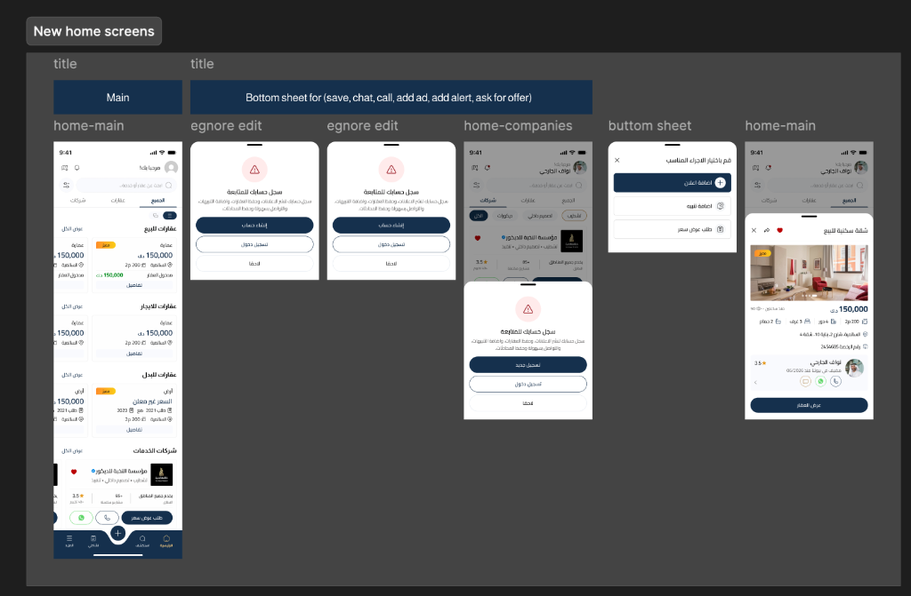

# Guest Flow and Authentication Bottom Sheet Specifications

This document outlines the UX/UI flow and behaviors for guest users in the Buyootna mobile application, specifically covering the **Home/Main screen** and the **Authentication Prompts (Bottom Sheet)** triggered by restricted actions.

---

## 1. Guest Home Screen (`home-main` & `home-companies`)

When a user opens the app as a guest, they have access to browse listings, categories, and service companies but cannot perform actions that modify data or involve user communication.

### UI Specifications:
* **Header / Greeting Area:**
  * Displays "مرحبا بك!" (Welcome!) with a generic placeholder profile avatar (gray outline).
  * *Authenticated User Comparison:* Displays the user's name (e.g., "نواف الجارحي") and their profile image.
* **Search Bar:**
  * Placeholder: "ابحث عن عقار أو خدمة..." (Search for property or service...).
* **Top Tabs:**
  * **الجميع (All):** Displays sections for Properties for Sale, Properties for Rent, Properties for Swap, and Service Companies.
  * **عقارات (Properties):** Filtered view for properties.
  * **شركات (Companies):** Filtered view for service companies.
* **Service Company Cards (`home-companies`):**
  * Displays the company logo, name, categories (e.g., تشطيب • تصميم داخللي • تنفيذ), overall rating (e.g., 3.5 ★), and number of completed projects.
  * Action buttons at the bottom of the card:
    1. **WhatsApp Chat** (Green round button)
    2. **Direct Call** (Phone outline button)
    3. **طلب عرض سعر (Request Quote)** (Primary dark blue button)

### Visual Reference:


---

## 2. Restricted Actions & Triggers

Certain actions are restricted to registered/logged-in users. When a guest user attempts to interact with these features, the application must intercept the action and display the **Authentication Bottom Sheet**.

### General Rule:
> [!IMPORTANT]
> **Universal Authentication Guard:** Any Action or CTA (Call-to-Action) such as WhatsApp, Phone Calls, Chat, Request Quote, Add Alert, or Writing a Review requires the user to sign up/log in. They must all trigger and show the Authentication Bottom Sheet.

| Trigger Action | UI Location | Expected Behavior |
| :--- | :--- | :--- |
| **Save/Favorite (حفظ)** | Heart icon on property/company cards or details pages | Open Authentication Bottom Sheet |
| **Chat (محادثة)** | Chat icon on listing details | Open Authentication Bottom Sheet |
| **Call (اتصال)** | Phone/Call icon | Open Authentication Bottom Sheet |
| **WhatsApp (واتساب)** | WhatsApp icon on cards or detail pages | Open Authentication Bottom Sheet |
| **Add Ad (اضافة اعلان)** | Center `+` button in Bottom Tab Bar | Open Authentication Bottom Sheet |
| **Add Alert (اضافة تنبيه)** | Inside Alerts section or search filters | Open Authentication Bottom Sheet |
| **Ask for Offer (طلب عرض سعر)** | Service Company cards or details page | Open Authentication Bottom Sheet |
| **Write Review (كتابة تقييم)** | Reviews section inside details pages | Open Authentication Bottom Sheet |

### Visual Reference:


---

## 3. Authentication Bottom Sheet (`egnore edit`)

The bottom sheet is the central gatekeeper for guest user interactions.

```
+------------------------------------------+
|                     =                    |  <- Drag handle
|                                          |
|                    /!\                   |  <- Warning icon (Red outline on light red bg)
|                                          |
|            سجل حسابك للمتابعة            |  <- Title
|                                          |
|   سجل حسابك لنشر الاعلانات، وحفظ العقارات، |  <- Description
|    واضافة التنبيهات، والتواصل بسهولة      |
|              وحفظ المحادثات.             |
|                                          |
|          +--------------------+          |
|          |    إنشاء حساب      |          |  <- Primary Button (Dark Blue background, white text)
|          +--------------------+          |
|                                          |
|          +--------------------+          |
|          |    تسجيل دخول     |          |  <- Secondary Button (White background, Dark Blue border)
|          +--------------------+          |
|                                          |
|                   لاحقا                  |  <- Close/Dismiss Option (Gray/Dark text, borderless)
|                                          |
+------------------------------------------+
```

### Content Copy (Arabic):
* **Title:** `سجل حسابك للمتابعة` (Register your account to continue)
* **Description:** `سجل حسابك لنشر الاعلانات، وحفظ العقارات، واضافة التنبيهات، والتواصل بسهولة وحفظ المحادثات.` (Register your account to publish ads, save properties, add alerts, and communicate easily while saving conversations.)
* **Primary Action:** `إنشاء حساب` or `تسجيل جديد` (Create Account / New Registration)
* **Secondary Action:** `تسجيل دخول` (Login)
* **Dismiss Action:** `لاحقا` (Later)

### Button Styles:
* **Create Account / New Registration:**
  * Background Color: `#15304D` (Dark Blue)
  * Text Color: `#FFFFFF` (White)
  * Shape: Rounded (Border Radius: 16px/24px)
* **Login:**
  * Background Color: `#FFFFFF` (White)
  * Border Color: `#15304D` (Dark Blue)
  * Text Color: `#15304D` (Dark Blue)
  * Shape: Rounded (Border Radius: 16px/24px)
* **Later:**
  * Background Color: Transparent
  * Text Color: `#6B6A6A` or `#111111`
  * Layout: Centered link

### Visual Reference:



---

## 4. Alternative/Actions Bottom Sheet (`buttom sheet`)

In scenarios where users click options like the center `+` button (when authenticated) or relevant shortcuts, they are presented with a selection bottom sheet to choose the desired action:

* **Header:** `قم باختيار الاجراء المناسب` (Please select the appropriate action) with a Close (`X`) button in the corner.
* **Options:**
  1. **اضافة اعلان (Add Ad):** Accompanied by a `+` icon inside a circle.
  2. **اضافة تنبيه (Add Alert):** Accompanied by a notification bell icon inside a circle.
  3. **طلب عرض سعر (Request Quote):** Accompanied by a document/offer list icon.

### Visual Reference:


---

## 5. Overview Flow Map

Here is the complete layout showing the flow transitions between guest home screen, the authentication prompt sheets, and details/actions view sheets:


