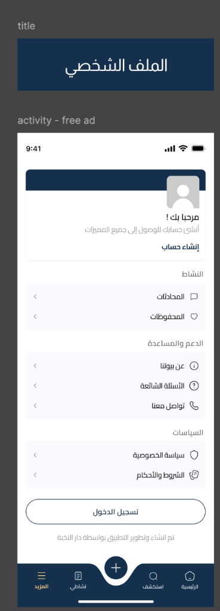
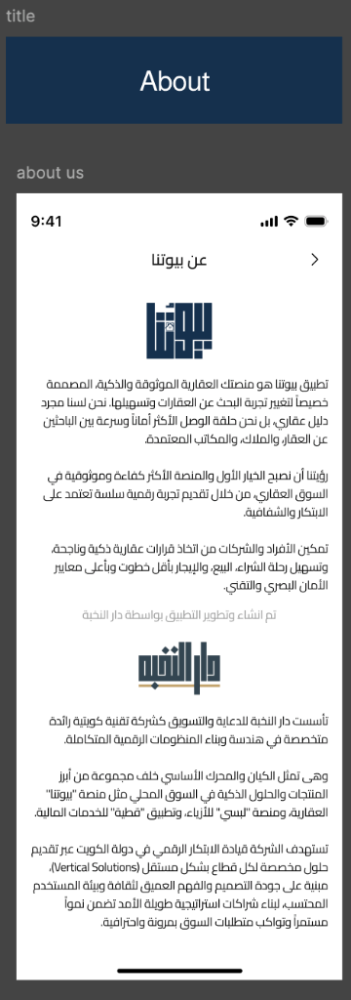
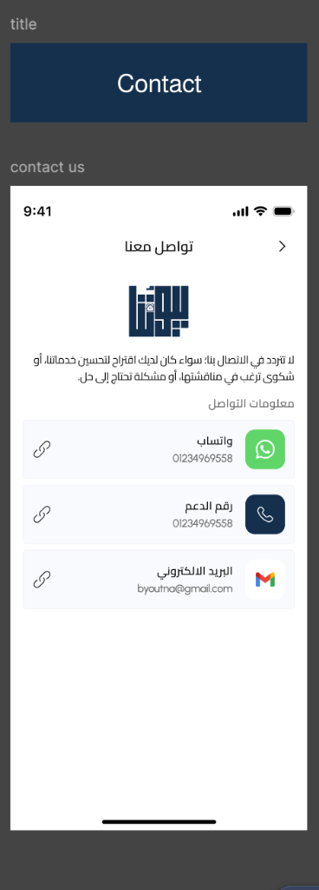
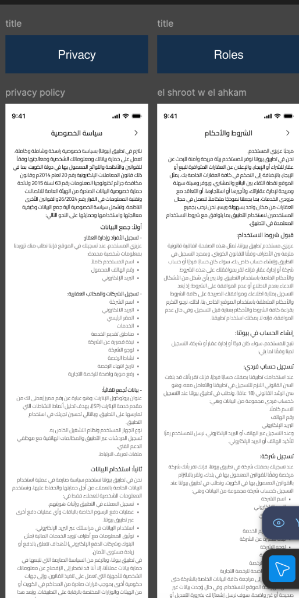

# More Screen & Sub-Pages Flow (Guest Mode)

This document outlines the UX/UI layout, behaviors, and sub-pages for the **More (المزيد)** tab when accessed by a guest user in the Buyootna mobile application.

---

## 1. More / Profile Main Screen (Guest Mode - `activity - free ad`)

The "More" tab serves as the main settings, account, and information hub. For guest users, it emphasizes registration prompts while still allowing access to help resources and policies.

### UI Specifications:
* **Account Status Card (Greeting Box):**
  * Placed at the top with a dark blue header bar and generic user outline avatar.
  * Title: `مرحبا بك !` (Welcome!)
  * Subtitle: `أنشئ حسابك للوصول إلى جميع المميزات` (Create your account to access all features)
  * Link: `إنشاء حساب` (Create Account) - navigates to the registration flow.
* **Activity Section (النشاط):**
  * **المحادثات (Chats):** Icon with text and chevron navigation. Tapping this triggers the Authentication Bottom Sheet.
  * **المحفوظات (Saved Items):** Icon with text and chevron navigation. Tapping this triggers the Authentication Bottom Sheet.
* **Support & Help Section (الدعم والمساعدة):**
  * **عن بيوتنا (About Buyootna):** Open the "About Us" page.
  * **الأسئلة الشائعة (FAQ):** Open the FAQs.
  * **تواصل معنا (Contact Us):** Open the "Contact Us" page.
* **Policies Section (السياسات):**
  * **سياسة الخصوصية (Privacy Policy):** Open the Privacy Policy page.
  * **الشروط والأحكام (Terms & Conditions):** Open the Terms and Conditions page.
* **Primary Bottom Button:**
  * Label: `تسجيل الدخول` (Login)
  * Style: Outlined/Bordered white button with dark blue text (`#15304D`).
* **Footer:**
  * Label: `تم انشاء وتطوير التطبيق بواسطة دار النخبة` (App built and developed by Dar Al-Nokhba)

### Visual Reference:

---

## 2. About Us Screen (`about-us`)

Provides details about Buyootna and its development partner, Dar Al-Nokhba.

### UI Specifications:
* **Header:** Title `عن بيوتنا` (About Buyootna) with a back navigation arrow.
* **Buyootna Section:**
  * Logo: "بيوتنا" (Buyootna) logo.
  * Content: Descriptive paragraphs about the platform's vision, smart real estate solutions, search experience, and goals.
* **Developer Section:**
  * Footer separator text: `تم انشاء وتطوير التطبيق بواسطة دار النخبة`
  * Logo: "دار النخبة" (Dar Al-Nokhba) logo.
  * Content: Context on Dar Al-Nokhba as a leading Kuwaiti tech and marketing agency.

### Visual Reference:

---

## 3. Contact Us Screen (`contact-us`)

Allows users to contact support through different channels.

### UI Specifications:
* **Header:** Title `تواصل معنا` (Contact Us) with a back navigation arrow.
* **Introductory Text:** Encourages users to reach out for suggestions, complaints, or problems.
* **Contact Information Rows (معلومات التواصل):**
  Each row contains a channel icon, label, contact handle, and a copy-to-clipboard shortcut link button on the left.
  1. **واتساب (WhatsApp):** `01234969558` (Green WhatsApp icon)
  2. **رقم الدعم (Support Number):** `01234969558` (Dark blue phone icon)
  3. **البريد الالكتروني (Email):** `byoutna@gmail.com` (Gmail mail icon)

### Visual Reference:

---

## 4. Privacy Policy & Terms Screens (`privacy-terms`)

Detailed legal information pages accessible without authentication.

* **Privacy Policy (سياسة الخصوصية):** Covers details regarding user data collection, usage, and security protocols in structured sections (e.g., أولاً: جمع البيانات, ثانياً: استخدام البيانات).
* **Terms & Conditions (الشروط والأحكام):** Lists guidelines for user accounts, property listings, and legal agreements.

### Visual Reference:

