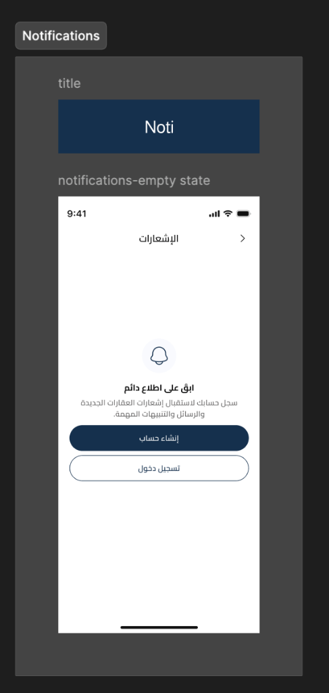
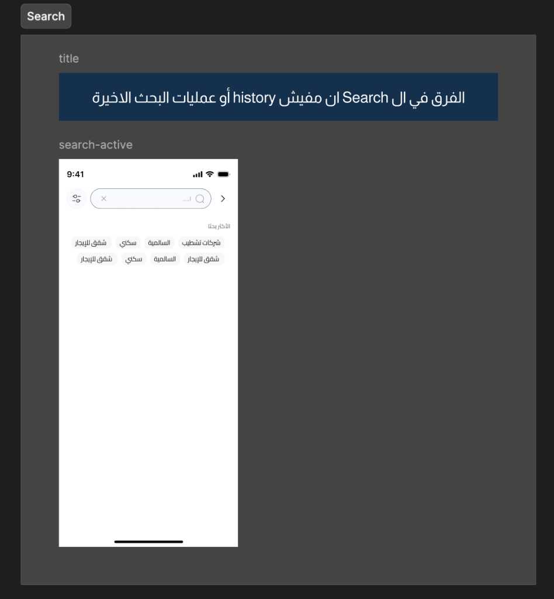
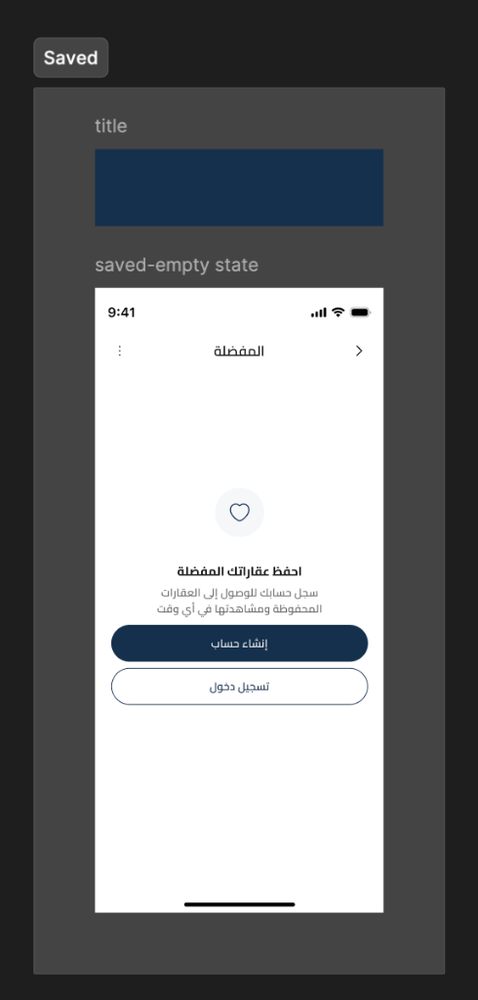
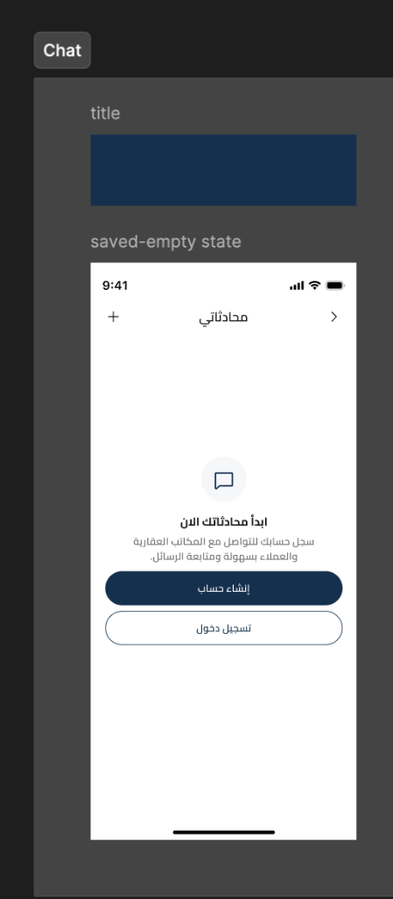
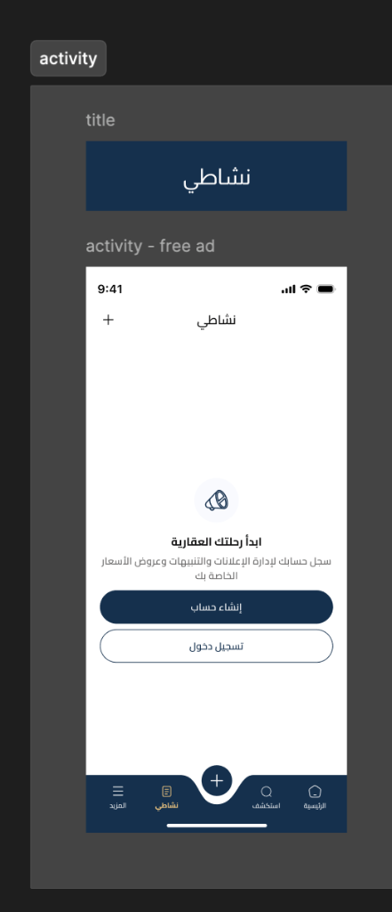

# Tabs & Features Empty States (Guest Mode)

This document outlines the UX/UI layout, behaviors, and specifications for various core screen empty states (Guest Mode) in the Buyootna mobile application, including Notifications, Search, Saved/Favorites, Chat, and Activity.

---

## 1. Notifications Screen (Guest/Empty State)

When a guest user navigates to the notifications screen (e.g., from the home header notification icon), they are prompted to authenticate to receive alerts.

### UI Specifications:
* **Header:** Title `الإشعارات` (Notifications) with a back navigation arrow.
* **Centered Content:**
  * Icon: Bell outline (with blue circles background).
  * Title: `ابق على اطلاع دائم` (Stay updated)
  * Description: `سجل حسابك لاستقبل إشعارات العقارات الجديدة والرسائل والتنبيهات المهمة.` (Register your account to receive notifications about new properties, messages, and important alerts.)
* **Action Buttons:**
  1. Primary Dark Blue Button (`#15304D`): `إنشاء حساب` (Create Account)
  2. Outlined/Bordered White Button: `تسجيل دخول` (Login)

### Visual Reference:

---

## 2. Search Screen (Guest Mode - `search-active`)

The search screen for guests has a specific behavioral restriction compared to logged-in users.

### Key Functional Rule:
> [!IMPORTANT]
> **No Search History:** Unlike authenticated users, guest users do not have a search history or recent searches section.

### UI Specifications:
* **Header Search Input:**
  * Text input with magnifying glass and close (`X`) clear button.
  * Back navigation arrow on the right.
  * Filter/settings toggle icon on the left.
* **Suggested Queries:**
  * Title: `الأكثر بحثاً` (Most Searched)
  * Display: Grid of clickable chips containing popular query terms:
    * `شركات تشطيب` (Finishing companies)
    * `السالمية` (Salmiya)
    * `سكني` (Residential)
    * `شقق للإيجار` (Apartments for rent)

### Visual Reference:

---

## 3. Saved / Favorites Screen (Guest/Empty State)

When a guest attempts to view saved/favorite listings (e.g., from the More screen or tab shortcuts), they are presented with an empty state prompting authentication.

### UI Specifications:
* **Header:** Title `المفضلة` (Favorites) with back button and three-dot action menu.
* **Centered Content:**
  * Icon: Heart outline (inside a circular background).
  * Title: `احفظ عقاراتك المفضلة` (Save your favorite properties)
  * Description: `سجل حسابك للوصول إلى العقارات المحفوظة ومشاهدتها في أي وقت` (Register your account to access saved properties and view them at any time.)
* **Action Buttons:**
  1. Primary Dark Blue Button (`#15304D`): `إنشاء حساب` (Create Account)
  2. Outlined/Bordered White Button: `تسجيل دخول` (Login)

### Visual Reference:

---

## 4. Chat Screen (Guest/Empty State)

When a guest attempts to view their inbox (e.g., from the More screen or tab shortcuts), they are presented with this state.

### UI Specifications:
* **Header:** Title `محادثاتي` (My Chats) with back button and `+` button.
* **Centered Content:**
  * Icon: Chat bubble outline (inside a circular background).
  * Title: `ابدأ محادثاتك الان` (Start your conversations now)
  * Description: `سجل حسابك للتواصل مع المكاتب العقارية والعملاء بسهولة ومتابعة الرسائل.` (Register your account to easily communicate with real estate offices and clients and follow up on messages.)
* **Action Buttons:**
  1. Primary Dark Blue Button (`#15304D`): `إنشاء حساب` (Create Account)
  2. Outlined/Bordered White Button: `تسجيل دخول` (Login)

### Visual Reference:

---

## 5. Activity Screen (Guest/Empty State)

The Activity tab in the bottom tab bar displays this prompt for guest users.

### UI Specifications:
* **Active Tab:** `نشاطي` (My Activity) is selected in the bottom navigation bar.
* **Header:** Title `نشاطي` (My Activity) with a `+` button.
* **Centered Content:**
  * Icon: Megaphone outline (inside a circular background).
  * Title: `ابدأ رحلتك العقارية` (Start your real estate journey)
  * Description: `سجل حسابك لإدارة الإعلانات والتنبيهات وعروض الأسعار الخاصة بك` (Register your account to manage your ads, alerts, and quotes.)
* **Action Buttons:**
  1. Primary Dark Blue Button (`#15304D`): `إنشاء حساب` (Create Account)
  2. Outlined/Bordered White Button: `تسجيل دخول` (Login)

### Visual Reference:

