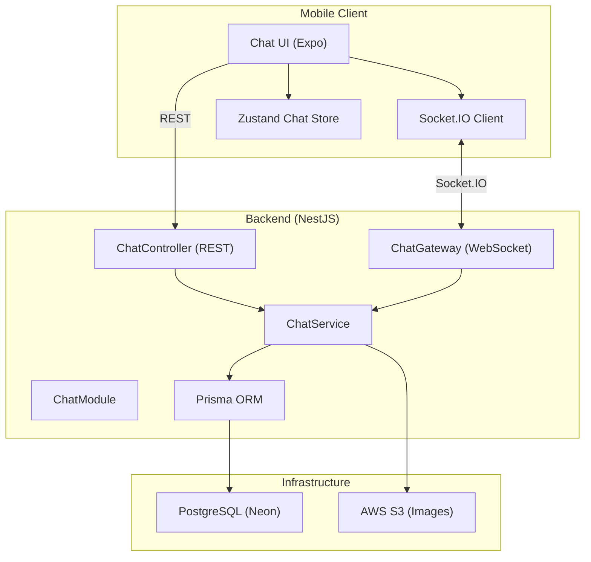

# 05 — Real-Time Chat / Messaging System

## Problem

The entire chat system is hardcoded with `MOCK_CHATS` and `MOCK_MESSAGES`. There is no backend messaging infrastructure. The chat is the most obvious "non-functional" feature to an App Store reviewer.

## Current State

- **Chat list** (`chat/index.tsx`): Uses `MOCK_CHATS` array, no API calls
- **Chat detail** (`chat/[id].tsx`): Uses `MOCK_MESSAGES`, send button logs to console
- **Backend**: No chat/messaging module, no Prisma models, no WebSocket gateway
- **Components**: `ChatHeader`, `ChatInputBar`, `MessageBubble`, `ImageMessageBubble`, `PropertyMessageBubble`, `DateSeparator` — all exist but consume mock data

---

## Architecture Overview



### Technology Choices

| Concern | Technology | Rationale |
|---------|-----------|-----------|
| **Real-time transport** | **Socket.IO** via `@nestjs/websockets` + `@nestjs/platform-socket.io` | Most mature WebSocket solution for NestJS. Auto-reconnect, room-based, binary support. Better than raw WS for mobile (handles flaky connections). |
| **Client SDK** | `socket.io-client` (npm) | Official client, works in React Native. |
| **Message persistence** | **PostgreSQL** via Prisma | Already the primary DB. Messages are relational (user → conversation → messages). No need for a separate message store at current scale. |
| **File/Image upload** | **AWS S3** (existing) | Reuse the existing `StorageService` for chat image uploads. Upload via REST, send URL via Socket. |
| **Push notifications** | **Expo Notifications** (future) | Not in scope for this plan but the architecture supports it. |

---

## Data Models

### Prisma Schema Additions

```prisma
// prisma/chat.prisma

model Conversation {
  id           String    @id @default(uuid())
  createdAt    DateTime  @default(now())
  updatedAt    DateTime  @updatedAt
  
  // Optional property context (conversations can be about a specific listing)
  propertyId   String?
  property     Property? @relation(fields: [propertyId], references: [id], onDelete: SetNull)
  
  participants ConversationParticipant[]
  messages     Message[]
}

model ConversationParticipant {
  id             String       @id @default(uuid())
  conversationId String
  userId         String
  joinedAt       DateTime     @default(now())
  lastReadAt     DateTime?    // Track read status per participant
  
  conversation   Conversation @relation(fields: [conversationId], references: [id], onDelete: Cascade)
  user           User         @relation(fields: [userId], references: [id], onDelete: Cascade)
  
  @@unique([conversationId, userId])  // User can only be in a conversation once
  @@index([userId])
  @@index([conversationId])
}

model Message {
  id             String       @id @default(uuid())
  conversationId String
  senderId       String
  
  type           MessageType  @default(TEXT)
  content        String?      // Text content
  imageUrl       String?      // For IMAGE type
  propertyId     String?      // For PROPERTY type (shared listing card)
  
  createdAt      DateTime     @default(now())
  
  conversation   Conversation @relation(fields: [conversationId], references: [id], onDelete: Cascade)
  sender         User         @relation(fields: [senderId], references: [id], onDelete: Cascade)
  
  @@index([conversationId, createdAt])
  @@index([senderId])
}

enum MessageType {
  TEXT
  IMAGE
  PROPERTY
}
```

Also add to existing models:
```prisma
// User model
model User {
  // ... existing
  conversations ConversationParticipant[]
  messages      Message[]
}

// Property model  
model Property {
  // ... existing
  conversations Conversation[]
}
```

---

## Backend Implementation

### Module Structure

```
src/features/chat/
├── chat.module.ts
├── chat.controller.ts      # REST endpoints
├── chat.gateway.ts          # WebSocket gateway (Socket.IO)
├── chat.service.ts          # Business logic
├── dto/
│   ├── create-conversation.dto.ts
│   ├── send-message.dto.ts
│   └── get-conversations.dto.ts
└── types/
    └── chat-events.ts       # Socket event type definitions
```

### REST Endpoints (`ChatController`)

```
GET    /chat/conversations              → List user's conversations (paginated)
POST   /chat/conversations              → Create or find existing conversation
GET    /chat/conversations/:id          → Get conversation details
GET    /chat/conversations/:id/messages → Get messages (cursor-based pagination)
POST   /chat/conversations/:id/read     → Mark conversation as read
DELETE /chat/conversations/:id          → Delete/leave conversation
POST   /chat/upload                     → Upload chat image to S3
```

All endpoints require `@UseGuards(AuthGuard('jwt'))`.

### WebSocket Gateway (`ChatGateway`)

```typescript
@WebSocketGateway({
  namespace: '/chat',
  cors: { origin: '*' },
})
export class ChatGateway implements OnGatewayConnection, OnGatewayDisconnect {
  
  // --- Connection Lifecycle ---
  handleConnection(client: Socket)     // Authenticate via JWT in handshake
  handleDisconnect(client: Socket)     // Cleanup

  // --- Events (Client → Server) ---
  @SubscribeMessage('join_conversation')
  handleJoin(client, conversationId)   // Join a Socket.IO room
  
  @SubscribeMessage('leave_conversation')
  handleLeave(client, conversationId)  // Leave a room
  
  @SubscribeMessage('send_message')
  handleMessage(client, payload)       // Persist + broadcast to room
  
  @SubscribeMessage('typing')
  handleTyping(client, conversationId) // Broadcast typing indicator
  
  @SubscribeMessage('stop_typing')
  handleStopTyping(client, conversationId)

  // --- Events (Server → Client) ---
  // 'new_message'        → Broadcast new message to room participants
  // 'user_typing'        → Broadcast typing indicator
  // 'user_stopped_typing'
  // 'message_read'       → Notify sender their message was read
  // 'conversation_updated' → New unread count, last message preview
}
```

### Authentication Flow

```
1. Client connects: socket.io-client with auth: { token: JWT }
2. Gateway handleConnection():
   - Extract token from client.handshake.auth.token
   - Verify JWT using JwtService
   - Store userId on socket: client.data.userId = decoded.sub
   - Auto-join user's personal room: client.join(`user:${userId}`)
3. On disconnect: cleanup rooms
```

### Chat Service (`ChatService`)

Key methods:

```typescript
class ChatService {
  // Create or find existing 1:1 conversation between two users
  // Optionally attached to a property context
  async findOrCreateConversation(userId: string, recipientId: string, propertyId?: string): Promise<Conversation>
  
  // Send a message (called by both REST and WebSocket)
  async sendMessage(senderId: string, conversationId: string, dto: SendMessageDto): Promise<Message>
  
  // Get user's conversations with last message + unread count
  async getConversations(userId: string, page: number, limit: number): Promise<PaginatedResponse<ConversationSummary>>
  
  // Get messages for a conversation (cursor-based for infinite scroll)
  async getMessages(conversationId: string, cursor?: string, limit?: number): Promise<CursorPaginatedResponse<Message>>
  
  // Mark messages as read
  async markAsRead(userId: string, conversationId: string): Promise<void>
  
  // Upload chat image
  async uploadImage(file: Express.Multer.File): Promise<{ url: string }>
}
```

### Conversation Summary Shape (returned to client)

```typescript
interface ConversationSummary {
  id: string;
  otherUser: {
    id: string;
    name: string;
    avatarUrl: string | null;
  };
  propertyContext?: {
    id: string;
    title: string;
    imageUrl: string;
  };
  lastMessage: {
    content: string | null;
    type: MessageType;
    createdAt: string;
    isMine: boolean;
  };
  unreadCount: number;
}
```

---

## Mobile Implementation

### New Files

| File | Purpose |
|------|---------|
| `src/core/api/chat.service.ts` | REST API calls for chat |
| `src/core/services/socket.service.ts` | Socket.IO client singleton |
| `src/store/useChatStore.ts` | Zustand store for conversations + messages |
| `src/hooks/useChat.ts` | Hook combining REST + Socket.IO for a conversation |

### Socket.IO Client

```typescript
// src/core/services/socket.service.ts
import { io, Socket } from 'socket.io-client';

class SocketService {
  private socket: Socket | null = null;
  
  connect(token: string) {
    this.socket = io(`${API_URL}/chat`, {
      auth: { token },
      transports: ['websocket'],  // Skip polling, go straight to WS
      reconnection: true,
      reconnectionDelay: 1000,
      reconnectionAttempts: 10,
    });
    
    this.socket.on('connect', () => console.log('Socket connected'));
    this.socket.on('disconnect', () => console.log('Socket disconnected'));
  }
  
  disconnect() { this.socket?.disconnect(); }
  
  joinConversation(id: string) { this.socket?.emit('join_conversation', id); }
  leaveConversation(id: string) { this.socket?.emit('leave_conversation', id); }
  
  sendMessage(conversationId: string, payload: any) {
    this.socket?.emit('send_message', { conversationId, ...payload });
  }
  
  onNewMessage(cb: (msg: Message) => void) {
    this.socket?.on('new_message', cb);
  }
  
  emitTyping(conversationId: string) {
    this.socket?.emit('typing', conversationId);
  }
  
  onUserTyping(cb: (data: { userId: string; conversationId: string }) => void) {
    this.socket?.on('user_typing', cb);
  }
}

export const socketService = new SocketService();
```

### Zustand Chat Store

```typescript
// src/store/useChatStore.ts
interface ChatState {
  conversations: ConversationSummary[];
  activeMessages: Map<string, Message[]>;  // conversationId → messages
  totalUnread: number;
  
  // Actions
  loadConversations: () => Promise<void>;
  loadMessages: (conversationId: string, cursor?: string) => Promise<void>;
  addMessage: (conversationId: string, message: Message) => void;  // Optimistic
  markRead: (conversationId: string) => void;
}
```

### Updated Screens

#### [MODIFY] `src/app/chat/index.tsx`
- Remove `MOCK_CHATS`
- Use `useChatStore.conversations`
- Connect to socket on mount, disconnect on unmount
- Listen for real-time conversation updates (new messages, read receipts)

#### [MODIFY] `src/app/chat/[id].tsx`
- Remove `MOCK_MESSAGES`
- Load messages via REST on mount (cursor-based)
- Join Socket.IO room on mount
- Send messages via Socket.IO
- Optimistic message rendering (show immediately, mark as "sending")
- Typing indicator
- Image upload via camera/gallery → S3 → send URL as IMAGE message

#### [MODIFY] `src/app/property/[id].tsx`
- Wire "Chat" button in `PropertyActionBar`:
  1. If not authenticated → show AuthGuardSheet
  2. If authenticated → call `chatService.findOrCreate(hostId, propertyId)`
  3. Navigate to `/chat/${conversationId}`

---

## Dependencies to Install

### Backend
```bash
pnpm add @nestjs/websockets @nestjs/platform-socket.io socket.io
pnpm add -D @types/socket.io
```

### Mobile
```bash
pnpm add socket.io-client
```

---

## Infrastructure Considerations

### Nginx WebSocket Proxy

The existing Nginx config must be updated to proxy WebSocket connections:

```nginx
location /chat {
    proxy_pass http://api:8000;
    proxy_http_version 1.1;
    proxy_set_header Upgrade $http_upgrade;
    proxy_set_header Connection "upgrade";
    proxy_set_header Host $host;
    proxy_set_header X-Real-IP $remote_addr;
}
```

### Scaling Notes (Future)

- At current scale (MVP), a single NestJS process with in-memory Socket.IO adapter is sufficient
- When scaling to multiple instances, add `@socket.io/redis-adapter` for cross-process pub/sub
- Consider rate limiting on message sends (prevent spam)

---

## Verification

- [ ] Creating a conversation from property detail navigates to chat
- [ ] Messages are sent in real-time and appear on both sides
- [ ] Messages persist across app restarts (loaded from REST API)
- [ ] Typing indicator shows when the other user is typing
- [ ] Unread count updates in real-time on the chat list
- [ ] Image messages upload to S3 and display correctly
- [ ] Property context card shows at top of relevant conversations
- [ ] Read receipts (double check marks) update when recipient opens chat
- [ ] Works when offline → queues messages and sends on reconnect
- [ ] Chat list search filters conversations by name/property
- [ ] Works on iPad layout
