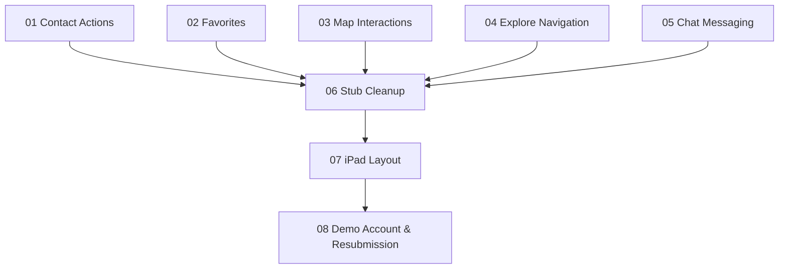

# Feature Plans — Apple 4.2.2 Fix

Master index of all feature plans needed to resolve the Guideline 4.2.2 rejection.

## Execution Order

Features are ordered by **dependency** and **impact** — earlier items unblock later ones.

| # | Plan File | Feature | Priority | Est. Effort |
|---|-----------|---------|----------|-------------|
| 1 | [01-contact-actions.md](file:///Users/macbook/Coding/remotely/buyootna/docs/plans/01-contact-actions.md) | Property Contact Actions (Call, WhatsApp, Share) | 🔴 Critical | 1 day |
| 2 | [02-favorites.md](file:///Users/macbook/Coding/remotely/buyootna/docs/plans/02-favorites.md) | Favorites / Saved Properties System | 🔴 Critical | 2-3 days |
| 3 | [03-map-interactions.md](file:///Users/macbook/Coding/remotely/buyootna/docs/plans/03-map-interactions.md) | Map Interactions (Full Map, Open in Maps) | 🟠 High | 1 day |
| 4 | [04-explore-navigation.md](file:///Users/macbook/Coding/remotely/buyootna/docs/plans/04-explore-navigation.md) | Explore Categories → Search Navigation | 🟠 High | 1 day |
| 5 | [05-chat-messaging.md](file:///Users/macbook/Coding/remotely/buyootna/docs/plans/05-chat-messaging.md) | Real-Time Chat / Messaging System | 🔴 Critical | 5-7 days |
| 6 | [06-stub-cleanup.md](file:///Users/macbook/Coding/remotely/buyootna/docs/plans/06-stub-cleanup.md) | Stub Cleanup & Non-Functional Feature Handling | 🟠 High | 1 day |
| 7 | [07-ipad-layout.md](file:///Users/macbook/Coding/remotely/buyootna/docs/plans/07-ipad-layout.md) | iPad Layout Optimization | 🟠 High | 2-3 days |
| 8 | [08-demo-account.md](file:///Users/macbook/Coding/remotely/buyootna/docs/plans/08-demo-account.md) | Demo Account & App Store Review Notes | 🔴 Critical | 0.5 day |

**Total Estimated Effort: ~14-17 days**

## Dependency Graph

## Tech Stack Reference

| Layer | Technology |
|-------|-----------|
| Mobile | Expo SDK 54, React Native 0.81, Expo Router 6, NativeWind/TailwindCSS 3 |
| State | Zustand 5 |
| Backend | NestJS 11, Prisma 7, PostgreSQL (Neon) |
| Storage | AWS S3 |
| Auth | JWT (passport-jwt) |
| Infra | Docker, Nginx, Let's Encrypt |
